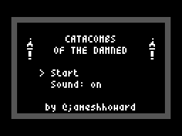
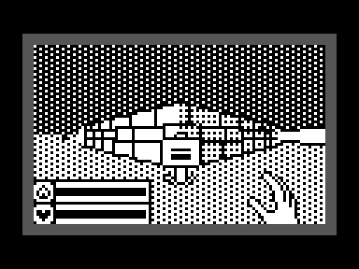
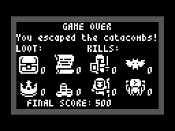

# Catacombs of the Damned! — Sega Master System

A port of James Howard's Arduboy game
[jhhoward/Arduboy3D](https://github.com/jhhoward/Arduboy3D) — a 1-bit textured
raycaster dungeon crawler — to the Sega Master System, built with
**devkitSMS** (SDCC `-mz80` + SMSlib + PSGlib).

**ROM:** `catacombs.sms` (48 KB, SEGA header present, checksum valid)

 


---

## What was ported

Everything. No subsystem is stubbed:

| Subsystem | Source | Notes |
|---|---|---|
| Renderer | `Draw.cpp` → `src/draw.c` | portal-less cell renderer, per-pixel-column walls, Bresenham vector wall textures, 1px sprite outlines, depth (`wBuffer`) + per-column horizon (tilt/bob), 12-entry sorted drawable queue |
| Dungeon generator | `MapGenerator.cpp` → `src/mapgen.c` | recursive BSP split, wall demolition, column decorations, "donut" pass, torches, monsters, urns, 8 treasure items, entrance/exit/sign |
| Enemies | `Enemy.cpp` → `src/enemy.c` | all four archetypes (skeleton, mage, bat, spider), idle → moving → attacking/stunned, target-cell pathing with inter-enemy reservation, ranged fire with line-of-sight |
| Player | `Player.cpp` → `src/player.c` | movement/strafe/turn, velocity + damping, camera tilt & bob, recoil shake, mana, pickups, chest opening, signs |
| Projectiles | `Projectile.cpp` | 4 slots, owner tracking, urn smashing (spider / potion / coins) |
| Particles | `Particle.cpp` | 3 systems × 8 particles with gravity |
| Menus / HUD | `Menu.cpp`, `Font.cpp` | title, sound toggle, "entering floor", game over with loot/kill tallies and the original scoring, fizzle-fade LFSR transition, 4×8 font, heart/mana bars, damage vignette |
| Art & LUTs | `SpriteData.inc.h`, `LUT.h`, `Textures.h` | every sprite, the font page, `scaleLUT`, the 256-entry sine table and the three vector wall textures, converted verbatim by `tools/gendata.py` |
| Sound | `Sounds.cpp` | all 8 ArduboyTones effect streams, replayed on PSG channel 2 by an interrupt-driven player |

The only deliberate content changes are **text re-flow** for the narrower
screen (the title is set on two lines, the game-over death lines are shortened
to ≤ 26 characters) — see `src/menu.c`.

## Controls

| SMS pad | Action |
|---|---|
| D-pad up / down | walk forward / back |
| D-pad left / right | turn |
| **Button 1** | cast a fireball (costs 20 mana), confirm in menus |
| **Button 2** (held) + left/right | strafe |

## How the Arduboy display becomes an SMS display

The Arduboy is a 128×64 1-bit framebuffer; the SMS has no framebuffer at all.
The port keeps the original **column-major 1bpp buffer** (one byte = 1 px wide
× 8 px tall) so that `DrawVLine`, the sprite blitter and the HUD code stay
byte-identical in behaviour, and converts it to 8×8 tiles every frame.

* **104×64 source, magnified 2×2 → 208×128 on screen.**  VRAM only has room
  for 448 tiles once the name table and sprite table are accounted for, and a
  2× magnified 128×64 picture would need 512; 104×64 → 26×16 = 416 tiles fits
  with slots to spare for the bezel. The field of view is unchanged because
  `NEAR_PLANE` scales with the width.
* **Only bitplane 0 is ever written.** Planes 1–3 are zeroed once at startup,
  the palette is `0 = black, 1 = white`, and a tile therefore costs 8 VDP
  writes instead of 32. Re-latching the VDP address for each plane-0 byte also
  spaces the data writes ~44 cycles apart, which satisfies the "pace your VRAM
  writes during active display" rule for free — the playtest asserts
  `expectpace 0` over ~150 000 VRAM writes.
* **Dirty-tile tracking.** A copy of the previous frame is kept and a tile
  whose four source nibbles did not change is skipped. In normal play ~60–85 %
  of tiles survive untouched (the playtest prints `blitTileCount`).

The blitter is generated assembly: `tools/genblit.py` → `src/blit.s`.

### RAM map

8 KB total, and two of the renderer's arrays are pinned at absolute addresses
because `src/hot.s` builds pointers into them from a page byte:

| address | size | what |
|---|---|---|
| `C000` | 16 B | `spreadTable` (nibble → byte spread for the blitter, page aligned) |
| `C010` | 18 B | `camera` |
| `C018`–`C807` | | game state: map, entities, enemies, projectiles, particles, menu |
| `C808` | 832 B | `screenBuffer` — the 104×64 column-major 1bpp framebuffer |
| `CBC1` | 832 B | `prevBuffer` — previous frame, for the dirty-tile diff |
| `CF01`–`D023` | | SMSlib / PSGlib state, SDCC initialised data |
| **`D200`** | 104 B | **`wBuffer`** (per-column depth) — must stay page aligned |
| **`D280`** | 104 B | **`horizonBuffer`** (per-column horizon) — must stay at `wBuffer + 0x80` |
| `D2E8`–`DF23` | 3131 B | free |
| `DF24`–`DFFF` | 220 B | stack (deepest observed, reported by `spmin`) |

The Makefile's link rule asserts the two pinned addresses after every build, so
a layout change fails loudly instead of silently miscompiling the column loop.

## Performance — read this

**The game runs at roughly 0.95 rendered frames per second** (~63 video frames
per rendered frame, ~2.9 M Z80 cycles of drawing plus ~0.6 M of logic). Game
logic is stepped separately, up to 6 ticks per rendered frame, so world time
advances about 5-6 Arduboy ticks per second rather than 30.

That is slow, and it is honest to say so: **this is a technically complete but
not a comfortably playable port.** The reason is arithmetic, not sloppiness -
the Arduboy's 16 MHz single-cycle AVR retires roughly 4-5x more work per second
than a 3.58 MHz Z80, and this engine draws walls one *pixel column* at a time
with per-pixel vector texturing and outlined scaled sprites.

### Where the frame goes

Measured with the bundled call-graph profiler (`make profile`, 900 video frames
of real play on a pinned seed), a rendered frame breaks down roughly as
(inclusive, so the indented rows are part of their parent):

| cost | per rendered frame |
|---|---|
| **`Game_Draw`** | **~2.9 M** |
| -> `DrawCells` (walls + cell contents) | ~2.2 M |
| ->> `DrawWall` -> `DrawWallSegment` | ~1.0 M |
| ->>> `WallColumnLoop` (assembly) | ~0.20 M |
| -> `RenderQueuedDrawables` (scaled sprites) | ~0.45 M |
| -> framebuffer -> VDP blit | ~0.13 M |
| **`Game_Tick` x 6 logic ticks** | **~0.60 M** |
| -> `Map_IsClearLine` (enemy line of sight) | ~0.35 M |

No single function is hot any more; the largest self-costs are
`DrawWallSegment` (6.5 %), the unrolled 32/16 divide `fm_d0` (6.5 %),
`DrawWallLine` (5.5 %), the 16x16 multiply `fm_m1` (4.9 %) and SDCC's
`__divuint` (4.8 %). About a fifth of the whole frame is fixed-point multiply
and divide, which is what a perspective raycaster on a Z80 costs.

### Optimisation log

The renderer has been through two rounds of work. The first took a straight
transcription from well over 10 M cycles a frame to ~5.0 M:

* the per-pixel sprite loop was replaced by a **byte-parallel** one that
  evaluates the outline rule eight pixels at a time, and the resampled source
  columns are **cached per source column** (16 per sprite) instead of being
  recomputed for every screen column - 7.9 M -> 5.5 M cycles/frame on its own;
* `src/fastmath.s` replaces SDCC's `__mullong` (~3600 cycles) and
  `__divslong` (~10 800 cycles) with a 16x16->32 multiply that takes an 8-bit
  fast path and a fully unrolled 32/16 divide;
* wall corners sit on cell boundaries, so the rotation `rotCos*(256*cx - camX)`
  splits exactly into a per-frame table lookup plus a constant - four
  multiplies per corner transform became four table reads;
* the sound interrupt rate was cut from 17 to 4 ticks per video frame;
* `Map_IsClearLine` was rewritten to use 16-bit fixed point instead of 32-bit
  math, which halved `Game_Tick`;
* sprites that fall entirely off-screen are now rejected up front - see bug 3,
  which cost ~22 % of the frame all by itself.

The second round took it from ~5.0 M to ~3.5 M (**-23 %** on the benchmark
scenes; 84 -> 63 video frames per rendered frame in play). Every step was
checked against six pixel-exact golden screenshots, so **the output is
bit-identical to the pre-optimisation renderer**:

| step | benchmark | note |
|---|---|---|
| starting point | 1997 | |
| `src/prims.s` - `PutPixelBlack` + `DrawWallColumn` in assembly | 1852 | -7.3 % |
| `src/hot.s` - map accessors + `isFrustrumClipped` in assembly | 1773 | the map accessors run ~9 500x per frame |
| `--max-allocs-per-node 25000` | 1741 | 6 s -> 3m45s build, -1.4 KB of ROM |
| `DrawCell` split; horizon table built without `__mulint` | 1634 | frustum test first, then one early-out on `cellType` |
| `u8` + pointer-walk column loops | 1607 | removes the spilled 16-bit index |
| `TransformCorner` in assembly, constants folded into four tables | 1595 | ~990 -> ~190 cycles per corner |
| `u8` wall height in the column loop | 1587 | `w` is provably <= 208 |
| `WallColumnLoop` - the whole column loop in assembly | 1560 | see below |
| final (all of the above at `ALLOCS=25000`) | **1534** | **-23.2 %** |

The benchmark is `tools/bench.sh`: video frames needed for 10 rendered frames
from four fixed camera positions, summed, lower is better. It also diffs the
six golden screenshots and fails on any pixel change. Both it and
`tests/golden.txt` freeze the world (`freezeLogic`) and poke the camera, so
they measure the renderer alone and are not affected by frame rate.

`WallColumnLoop` (in `src/hot.s`) is the one place where SDCC could not be
coaxed into good code: the loop needs eleven live values, so nearly every
access went through the `IX` frame at 19 cycles each. The assembly version
keeps the column pointer, the wall height, the Bresenham error and the step in
registers, which is only possible because `wBuffer` and `horizonBuffer` are
pinned at **0xD200** and **0xD280** - `&wBuffer[xi]` is then just
`(0xD2 << 8) | xi`, two instructions. The link rule re-checks both addresses
after every build, and the reference C loop is still in `src/draw.c` under
`#if WALL_COLUMN_LOOP_IN_C`.

Two things that are *not* worth retrying: `--fomit-frame-pointer` (SDCC 4.5.0
dies with an internal compiler error in `gen.c`), and moving the loop's locals
to file scope so they are addressed absolutely rather than through `IX` - that
measured 0.3 % *slower*.

The next steps, in order of expected payoff, would be: an assembly
`ResampleWord` and sprite blend (4.5 % + 3.2 % self), a cheaper 16/16 divide
for the four `K / viewZ` perspective divides, and - if those are not enough -
dropping the source resolution (the view size is a single `#define` in
`src/defines.h`, but the menu layouts assume >= 26 characters and 8 text rows).

### Loading a floor

Dungeon generation is also expensive, and it used to run with the screen
frozen on "ENTERING FLOOR 1" with no feedback for **755 video frames (≈ 12.6 s)**.
It is now **~358 frames (≈ 6.0 s)** with an animated progress bar:

| change | frames to enter floor 1 |
|---|---|
| original transcription | 755 |
| bounded ring search in `GetDistanceToCellType` → `IsCellTypeNear` | 373 |
| `Random() % n` → mask + rejection (17 call sites, `__moduint` was ~900 cycles) | ~350 |

The exact figure moves by a few percent between builds: the RNG is seeded by
the test script at whatever moment the title screen hands over, so a faster
menu hands over on a different frame and generates a different dungeon.

The bar itself is throttled to one redraw every 24 vblanks (15 redraws for a
whole floor): a full `Platform_Present` costs ~130 k cycles *regardless* of how
few tiles are dirty, because the dirty-tile diff scans all 416 tiles.

## Five bugs worth knowing about

**1. An SDCC 4.5.0 code-generation bug.** For

```c
void Game_SwitchState(u8 newState) { if (gameState != newState) { gameState = newState; … } }
```

SDCC emits a *destructive* `sub a,(hl)` for the comparison and then stores `A`
— i.e. it writes `newState - gameState` into the global. This silently broke
the whole state machine (the game generated a level then fell back to the
"entering floor" screen forever). Loading the global into a local first makes
SDCC emit `cp` instead.

`tools/checkasm.py` scans every generated `.asm` for the exact signature
(destructive compare → conditional branch → read of `A`) and `make check` fails
the build on a hit. The codebase is currently clean.

**2. A non-reentrant library call in an interrupt.** The PSG player runs in the
line/frame interrupt and needs `111861 / freq`. SDCC's `__divulong` keeps state
in static scratch, so firing a sound while the renderer was inside a 32-bit
divide corrupted the renderer's arithmetic — the player walked straight out of
the map. `PsgPeriod` in `src/fastmath.s` is a register-only divide and is safe
to call from an ISR.

**3. Off-screen sprites wrote past the end of the framebuffer.** In
`DrawScaledOutline` the vertical clip is computed in unsigned bytes:

```c
j1 = (u8)(y + size > DISPLAY_HEIGHT ? DISPLAY_HEIGHT - y : size);
```

For a sprite whose top edge is *below* the screen (`y > 63` — which happens
when the camera tilts, or for a dropped item seen from very close) this
underflows: `64 - 70` becomes 250, the "is it clipped away?" test passes, the
first page index `p0` becomes 8–10 and `pageOffsets[p0]` reads off the end of
its eight-entry table. The column blender then wrote 1–3 whole pages *past*
`screenBuffer`, and in this build the 76 bytes after the framebuffer are
`player.x`/`player.y`: after a few seconds of walking the player teleported to
(−1, −64) and stuck there, outside the map.

It was found by growing `screenBuffer` by 256 bytes, filling the tail with
`0xA5`, re-arming it before every render and scanning it after each phase of
`Renderer_Render` — which pointed straight at `RenderQueuedDrawables`.
The fix rejects fully off-screen sprites with *signed* comparisons before any
unsigned clipping arithmetic, and clamps the page count to `DISPLAY_PAGES - p0`.
Scenario 6 of the playtest now asserts the player stays inside the map bounds
after a long walk. As a bonus, those bogus sprites had been running the full
rasteriser with a 250-row loop: killing them took `DrawScaledOutline` from
811 k to 195 k cycles per call and made the whole game ~22 % faster.

**4. A held button froze the title screen.** `Menu_TickEnteringLevel()` only
advanced while `Platform_GetInput() == 0`, so a player who kept the button
pressed after choosing "Start" never left the "entering floor" screen (6000
frames in the harness), and mashing it was almost as bad. The transition is now
a plain frame timer, the menu consumes a press with `Platform_ConsumeInput()`
instead of waiting for a release, and the pad is latched in the frame interrupt
so a press shorter than one rendered frame (which can be 1.4 s long) is never
missed. `tests/playtest.txt` and the two scratch scripts `hold`/`mash` cover it.

**5. A wall edge far off-screen could hang the game.** Found by `make playtest`
after the optimisation round above, in code *this* work introduced. The
`DrawWallLine` column walk was rewritten to index with a `u8`, on the
assumption that the clipped line always starts on screen. It does not: a wall
edge seen at a sharp angle produces `x1 == x2 == 352`, which wrapped to column
96 - inside the loop range - while `dx` came out as 0, so the inner Bresenham
loop, which only ever adds `dx` to the error term, could never reach its exit
condition. The game froze with the VDP still on, which is exactly what a
"nothing moves any more" bug looks like from the outside.

```c
if (x1 >= DISPLAY_WIDTH) return;   /* nothing of this line is on screen */
if (x2 < 0) return;
```

Worth recording for two reasons. First, the six golden screenshots did *not*
catch it - they are rendered from frozen camera positions and none of them
happened to produce that geometry, while the scripted playtest, which walks
the player around, hit it within a few hundred frames. Pixel-diff tests and
behavioural tests catch different things and this project needs both. Second,
the symptom (`globalTickFrame` frozen, display still on) was diagnosed in one
step with the cycle profiler: dumping the per-function cycle counts over a
600-frame window showed 77 % of all cycles inside `DrawWallLine`, and the
per-instruction view pointed straight at the inner loop.

## Building

```sh
make                 # build catacombs.sms (3m45s - see ALLOCS below)
make ALLOCS=3000     # same, but ~6 s; for iterating, ~2 % slower code
make check           # re-emit all C as asm and scan for the SDCC miscompile
make playtest        # run the full scripted playtest in the headless emulator
make profile         # cycle-accurate call-graph profile of a fixed run
tools/bench.sh       # renderer benchmark + golden screenshot diff
make clean
```

The build is reproducible: unpacking the source archive on a clean machine
(SDCC 4.5.0, devkitSMS) and running `make` produces a `catacombs.sms` with the
same MD5 as the shipped ROM, `092b37cbcb22fc6ea48c8cd20eaedb74`, and
`make playtest`, `make check` and `tools/bench.sh` all pass from the fresh
tree.

`ALLOCS` is SDCC's `--max-allocs-per-node`. The default of 25000 is worth
~2 % of frame time and 1.4 KB of ROM over the stock 3000, at the cost of a
four-minute build; `make ALLOCS=3000` is the one to use while editing.

Requires devkitSMS in `~/.devkitsms` (override with `DK=`), SDCC ≥ 4.2 and
Python 3. On a bare machine that is `sudo apt-get install -y sdcc`, then
devkitSMS (`ihx2sms`, `smstest`, `SMSlib`, `PSGlib`) unpacked into
`~/.devkitsms` with its `bin/` made executable. `src/blit.s` and `src/gamedata.{c,h}` are generated by the scripts in
`tools/` and are regenerated by the Makefile when their generators change.

### Layout

```
src/
  main.c          entry point, frame loop, adaptive logic-tick rate
  platform.c/.h   framebuffer primitives, VDP/palette/name-table setup,
                  controller, ArduboyTones-compatible PSG player
  blit.s          GENERATED - framebuffer -> VDP tile blitter
  fastmath.s/.h   MulShift8 / MulDivS / PsgPeriod
  prims.s         assembly PutPixelBlack and DrawWallColumn
  hot.s           assembly map accessors, frustum cull, corner transform
                  and the DrawWallSegment column loop
  draw.c/.h       renderer (Draw.cpp)
  mapgen.c/.h     dungeon generator (MapGenerator.cpp)
  enemy, player, projectile, particle, map, entity, menu, font, game, fixedmath
  gamedata.c/.h   GENERATED - all art, LUTs and sound effects
tools/
  genblit.py      emits src/blit.s
  gendata.py      converts the Arduboy PROGMEM blobs to C
  checkasm.py     SDCC miscompile scanner
  prof3.py        call-graph profiler (reads the emulator's cycle dump;
                  the stock prof2.py mis-parses this SDCC's listings)
  bench.sh        four-scene renderer benchmark + golden image diff
tests/
  playtest.txt    13-scenario scripted playtest (make playtest)
  prof.txt        deterministic profiling run (make profile)
  hold.txt        regression: button held from boot must still reach play
  mash.txt        regression: button mashed must still reach play
  loadtime.txt    reports floor-1 load time and loading-bar redraw count
  golden.txt      six frozen-world camera positions, compared pixel by pixel
  golden.md5      the reference hashes for those six frames
  bench.txt       four of the same scenes, timed
  fps.txt, smoke.txt, scene.txt, walk.txt, shot.txt, repro.txt
                  scratch scripts kept from debugging sessions
shots/            screenshots: 00-07 from the playtest, g0-g5 the golden frames
build/            generated (object files, listings, profiler dumps)
```

## Verification

`make playtest` runs 13 scenarios in the bundled headless emulator and
currently reports **ALL PASSED** (37 assertions). It covers:

1. boot — display on, ≥ 3 distinct colours, state = Menu, floor = 1
2. menu — D-pad moves the cursor, button 1 toggles `audioEnabled` off and on
3. starting a game from the title
4. level generation with a pinned RNG seed — floor 1 is ready after 358 video
   frames — and hp = mana = 100 on entry
5. the generated map really contains the entrance at cell (1,1)
6. holding UP walks the player forward **and collision keeps them inside the
   map** (the bounds assertions here are the regression test for bug 3)
7. holding RIGHT changes `player.angle`
8. button 1 spends mana (a fireball is cast)
9. damage bookkeeping
10. hp = 0 → fizzle fade → game-over screen
11. the game-over screen returns to the title on a button press
12. a second run reaches **floor 2** through the exit stairs, with hp carried over
13. `expectpace 0` — no VDP writes packed too tightly during active display
    (~150 000 writes), and `spmin` shows 220 bytes of stack in use and ~3 KB free

On top of that, `tools/bench.sh` renders six frozen-world scenes and compares
them to stored MD5s. Every optimisation listed above was required to leave all
six **pixel-identical**, which is what makes the "the output did not change"
claim checkable rather than a hope. Bug 5 is the reminder that it only covers
what those six frames draw - `make playtest` is what caught that one.

Two scratch scripts next to it cover the input regressions from bug 4:
`hold` (button 1 pressed from boot and never released) and `mash` (button 1
pulsed 40 frames on / 40 off) must both reach the in-game state.

### Not verified

* **Real hardware.** Everything here is the `smstest` harness. The VRAM pacing
  check (`expectpace`) is the harness's model of the VDP, not a scope trace.
* **PAL timing.** The PSG note periods assume the NTSC 3.579545 MHz clock and
  the sound tick assumes a 60 Hz frame.
* **A full ten-floor human playthrough.** Floors 1 and 2 were reached under
  script; floors 3–10 use the same generator and the win condition
  (`floor == 10` → game over with "You escaped the catacombs!") was exercised
  only by reaching the game-over screen, not by playing through.
* **Emulicious / accurate-emulator sanity pass** (the skill recommends one).
* Audio was checked only for not crashing and not corrupting the renderer; the
  effects have not been listened to.
* **The 76-byte gap behind the framebuffer.** Bug 3 is fixed at the source, and
  a 256-byte guard page confirmed zero overflow writes across a full play
  session — but the guard is debug-only scaffolding and is not in the shipped
  ROM, so a *new* out-of-bounds writer would again land on live variables.

## Credits & licence

Original game and all art © James Howard, from
[jhhoward/Arduboy3D](https://github.com/jhhoward/Arduboy3D). This port carries
the upstream project's terms. devkitSMS (SMSlib/PSGlib/crt0) by sverx.
